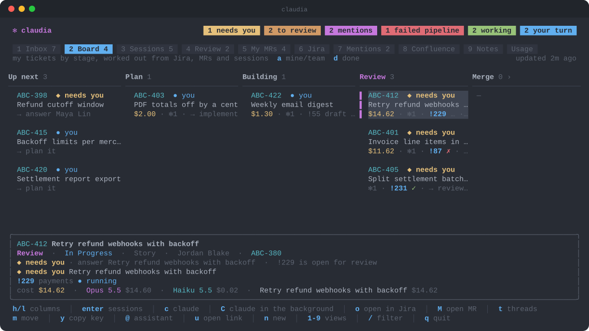

<p align="center">
  
</p>

<h1 align="center">claudia</h1>

<p align="center">
  <b>A terminal cockpit for Claude Code.</b><br>
  Who's waiting on you, your merge requests, your sprint and every Claude session, in one TUI.
</p>

<p align="center">
  <a href="https://github.com/MartyJRE/claudia/actions/workflows/ci.yml"></a>
  
  
  
  
  
</p>

<p align="center">
  
</p>

claudia lists review requests, Jira and Confluence mentions, Teams messages,
review threads on your MRs and Claude sessions that need input, oldest first, and jumps you into the
right Claude Code session for each: a review, a drafted reply, the fixes.

Claude itself always runs as the real `claude` CLI in tmux windows, so nothing
of Claude Code is reimplemented or lost. claudia only finds, starts, resumes and
switches between those sessions.

## Views

| Key | View | What it shows |
|---|---|---|
| 1 | Inbox | Everyone waiting on you, oldest first |
| 2 | Board | Your tickets and the reviews waiting on you as a kanban, by stage, with whose turn it is and what each cost |
| 3 | Sessions | Live and recent Claude sessions with status, branch, ticket, model, and a line on where each stands |
| 4 | Review | MRs where you are a reviewer and haven't approved yet |
| 5 | My MRs | Your open MRs (reviewers, pipelines, review threads) and recently merged ones |
| 6 | Jira | Your sprint, or the team's |
| 7 | Mentions | Jira comments and Confluence pages that mention you |
| 8 | Confluence | Pages you edited recently |
| 9 | Notes | Your Obsidian vault as a folder tree, or recently edited first |
| `tab` | Usage | Tokens and API-equivalent cost per day or per ticket, plan limits |
| `tab` | Standup | What you did since the last standup, what's on today, what's blocked |

Every view lists its keys in the footer, and every key can be rebound (see
`keys` under [Configuration](#configuration)).

## Board



Your sprint's tickets in columns: Up next, Plan, Building, Review, Merge and QA.
Each card says whose turn it is: `◆ needs you` (a session asks, or the Inbox has
something for the ticket; these go first), Claude at work with its activity, or
`⧗ waiting` on reviewers, someone a session named, a ticket it's blocked by, or
a status on hold. Otherwise it's yours and the card shows the next step. Its
last line has the ticket's cost so far, its sessions, MRs and that step.

On arrival `←`/`→` switch tabs as anywhere else; `↓` steps into the board, and
`↑` on a column's top card (or `esc`) steps back out.

| Key | On a ticket card |
|---|---|
| `h`/`l`, `←`/`→` | move between columns |
| `enter` | the session that waits on you, else the ticket's sessions, else start one |
| `c` / `C` | start Claude on it (in the background with `C`); a session that waits on you comes first |
| `s` / `S` | start the next step (in the background with `S`), see [Steps](#steps) |
| `v` / `p` | go to the session that planned it / OK the plan, see [Plans and blockers](#plans-and-blockers) |
| `*` / `K` / `J` | pin it into the agreed order or take it out / move it up / down, see [Agreed order](#agreed-order) |
| `A` / `P` | this card's autopilot modes / pause the autopilot, see [The autopilot](#the-autopilot) |
| `o` / `M` / `t` | open it in Jira / its MR / the MR's review threads |
| `m` / `y` | move it in Jira / copy its key |
| `a` / `d` / `f` / `r` | the team's sprint / show Done / step through the coming sprints / tickets, reviews or all |
| `T` | note a todo that isn't in Jira, see [Todos](#todos) |

### Stages

No stage is stored; each refresh works it out from Jira, your MRs and sessions,
first match from the right:

- **QA**: a merged MR and no open one.
- **Merge**: an approved MR with a green pipeline and no open threads.
- **Review**: an open MR.
- **Building**: a draft MR, an implementation, fix or test session, or Claude
  working on the ticket's branch.
- **Plan**: an analysis session or a plan.

The Jira status counts too, since merged MRs drop out of GitLab's list after a
few days: a ticket goes to the further of the two, so one in testing sits in QA.
`board.statuses` can pin a Jira status to a column. Done tickets join as a last
column with `d`. Tickets planned for a future sprint are folded under Up next,
and `f` steps the board through the coming sprints and back (the subtitle names
the sprint shown).

### Review cards

Reviews are a second kind of card, tinted apart: one per open, non-draft MR
where you're a reviewer, with stages of their own:

- **Requested**: no review yet, or a push since Claude reviewed it (for a review
  `s` didn't start, any change to the MR counts).
- **Reviewing**: a review session is at work.
- **Check findings**: the session stopped; the card shows the first line of what
  it found and needs you.
- **Waiting on author**: you reviewed without approving.
- **Done** once you approve, shown with `d`.

`r` cycles the board between Tickets, Reviews (those columns) and All (review
cards in the ticket columns: Requested under Up next, Reviewing under Building,
Check findings under Review, Waiting on author under Merge), and remembers the
choice. On Tickets a ticket whose MR waits on your review needs you; on Reviews
and All the review card says so instead. On a review card `enter` and `c` go to
the review session that waits on you, else `enter` lists its review sessions and
`c` reviews it with Claude (`C` starts a fresh review in the background); `o`
opens the MR, `t` its threads and `y` copies its link. `f` steps through sprints
for tickets only. Mentions, Teams posts and mail stay in the Inbox and never
make cards.

### Steps

Each card's last line is its step strip, one segment per step: readiness, plan,
implement, open MR, feedback, merge and QA notes for a ticket; review and
findings for a review. Green is done, blue running, yellow needs you, red
failed, dim not run yet, and the end of the strip says what happens next.

`s` starts the card's next step now, skipping steps already done; `S` starts it
in the background; on a step that's running or waiting on you it jumps to the
session instead. A ticket's step runs in the repo on the ticket's branch, the
one you picked for it before, or the only clone of its MR, and asks only when
that's unclear.

- **Readiness** checks the ticket is specified well enough and, if not, posts its
  questions on the ticket (or its Confluence page) through the Atlassian MCP,
  mentioning whoever last wrote the description (or a colleague it credits,
  while their account is active). The card then waits for answers; when the
  ticket changes, the same session is resumed to check again.
- **Plan** and **implement** are the analysis and implementation sessions.
- **Open MR** pushes and runs `glab mr create`.
- **Feedback** addresses the threads on your MR.
- **Merge** is the one step without a session: it merges the ready MR through
  GitLab, after a second press.
- **QA notes** comments for the tester.
- **Review** is the review session.

The prompts are `analysis_prompt`, `implementation_prompt`, `review_prompt`,
`readiness_prompt`, `mr_prompt` and `qa_prompt`. Whatever a run posts to Jira or
Confluence starts with an info panel saying Claude wrote it, and on GitLab with
a quote of the same sentence (`autopilot.comment_note`).

A run is told to end with a line `CLAUDIA_RESULT: ok|needs-you|waiting|failed — reason`
(a plan adds `size: simple|medium|large`, a review `no findings` when clean).
Waiting means it asked someone else and can't go on until they answer, which
shows a dim `⧗` and stays out of the Inbox. Without a result line the session's
summary decides, and a session that exits with neither failed. A run whose
context fills up waits on you as `context full`, since nothing compacts it on
its own; its card shows `ctx 82%` while it runs and the watcher pings you once
at 90%. The detail panel shows the run now under way, the one before, what's
next and each step's mode.

Runs, the cost ledger and the autopilot's state are kept in `state.db` in the
state dir, which the watcher keeps current with claudia closed. A review run
remembers the commit it read, so only a push sends the card back to Requested.

### Plans and blockers

A ticket in Plan by its Jira status alone gets planned first: `p` with no plan
yet says so rather than letting implement start. The plan step keeps its plan in
`plans/<KEY>.md` in the state dir, and implement follows that file. `v` on a
card goes to the session that planned it (resumed if its window was closed), to
read the plan and iterate on it there; the file stays up to date as you do. `p`
then OKs it; an OK given before the latest plan was written doesn't count.

When Jira says a ticket "is blocked by" one that isn't done, readiness and plan
still run, but implement and everything after it wait: the card shows
`⧗ waits on ABC-1`, the autopilot leaves it, and `s` says why. It picks up on
its own once the blocker is done.

### Todos

Some work never reaches Jira: someone stops by and asks. `T` notes it as a
todo, with who asked, and it joins Up next with a tint of its own. On a todo
card, `s` (or `enter`, `c`) starts a Claude session that drafts a ticket for it
and creates it in Jira only after your OK in that session; the ticket then
takes the todo's place, its spot in the agreed order included. The project is
the todo's own, the only one in `todos.projects` (default: `jira_project`), or
one you pick with the first preselected. `x` ticks off a todo that needs no
ticket, and `*` pins it into the agreed order like any card.

```sh
claudia ctl todo add "rotate the staging certs" --from Zdeněk --project OPS
claudia ctl todo                  # open todos and the ones done lately, as JSON
claudia ctl todo ticket 3 OPS-12  # the session does this once the ticket exists
claudia ctl todo done 3
```

### Agreed order

Priorities get agreed out loud, at standup or grooming, more often than in Jira.
`*` pins a card into that agreed order (last), or takes it out; `K`/`J` move it
up and down. Pinned cards show their place (`①`, `②`, …) and go first in their
column, and the autopilot takes them first within each tier of its queue. The
detail panel says when it was agreed (and by whom, when a note was given). It's
kept in `state.db`, never written to Jira, and an agreement lapses when the
sprint it was agreed in closes.

A Claude session can set the whole order from meeting notes:

```sh
claudia ctl prio ABC-12 payments!231 ABC-9 --note "Zdeněk, grooming"
claudia ctl prio            # the order now, as JSON
claudia ctl prio --clear
```

Cards are ticket keys, MR links or `!IID` (`repo!IID` when two repos have it).

### The autopilot

The autopilot starts steps without you, from the watcher, so it works with
claudia closed. It's off unless `autopilot.enabled` is set. Each step has a
mode, set per step in `autopilot.steps`:

| Mode | What happens | The card says |
|---|---|---|
| `auto` | the autopilot starts it when the limits allow | `◷ plan queued` |
| `after-plan-ok` (implement) | auto once `p` OKs the plan, or right away when the plan run called the change simple | `◆ plan OK? · p` |
| `ask` | waits for `s` | `◆ go ahead with merge? · s` |
| `off` | never offered | nothing |

Readiness, plan, open MR, feedback, QA notes and review are `auto` by default,
implement `after-plan-ok`, merge `ask`; merge is never `auto` without
`autopilot.allow_auto_merge`. `A` on a card overrides the modes for that card
only (all auto, ask before every step, off, or step by step), shown as `⚙ ask`
on the card. The most blocking step goes first: merge, feedback, review, QA
notes, readiness, plan, open MR, implement; within each, the
[agreed order](#agreed-order), then Jira's rank.

Before anything starts, the limits apply:

- **Hours**: `autopilot.hours` and `days` (Monday to Friday, 9 to 6).
- **Runs**: `max_running` at once (1, yours included, and never two on one card).
- **Plan usage**: under `max_five_hour` (60%, or `max_five_hour_after_hours`,
  90%, for a window that resets after hours) and `max_seven_day` (80%). When the
  status line hasn't saved the plan usage lately it's unknown, and only one run
  goes at a time.
- **Cost**: at most `max_ticket_usd` ($50) per ticket and `max_day_usd` ($30) a
  day of the autopilot's runs.
- **Reviews**: one per `review_every` (1h), most recently active MR first; a
  review request whose MR saw no activity for `review_stale_after` (720h, 30
  days) isn't reviewed on its own.

When a limit hits, nothing running is stopped; the header pill says why
(`⏸ autopilot: 5h window 64%`) and a notification says when it pauses and
resumes. `P` pauses it by hand, and the pause holds across restarts until you
press `P` again. A step that failed twice on its own waits for `s`.

A clean review on a green pipeline and the head it read is approved, and the
MR's Teams post gets ✅ (`autopilot.review_approve`, `autopilot.review_react`);
findings ping you. Runs the autopilot starts get `--permission-mode` from
`autopilot.permission_mode` (`auto` by default; `bypassPermissions` has no
sandbox behind it), and it stays off a card while someone works it in a session
of their own. A run it started that ended ok or waits on someone closes its
window after two idle minutes (never one sharing its window, and never one that
needs you or failed); the transcript stays, so `enter` on the card resumes it.
The autopilot's runs sit apart in Sessions, in a folded **autopilot runs**
group at the bottom; one that needs you still shows in the Inbox and on the
Board.

## Sessions


Sessions are grouped by repo, each with its `/color` dot. Under each one, a
line says where it stands ("OK to merge?", "Waiting: Michal to approve",
"PR #5 open"). The watcher writes it on Haiku when the session stops, from the
last few turns, in a separate headless run that leaves the session itself
alone. When it says Claude is asking you something, the session shows
`◆ needs you` and joins the Inbox, as if it were waiting on a prompt; when it
says the work is done, `✓ done`, so finished sessions stand out to close.

While Claude works, the status says what at, from its newest tool call:
`running` a command, `editing` or `reading` a file, `delegating` to agents,
`thinking` between calls (`reviewing` in a review session), each with its own
small looping glyph, and the command or file follows the session's name.

The live ones stay in the order they started, so activity never reshuffles the
list. A group holding a single session is just that session's row, with the
group named on it. Below them, **Recently closed** keeps the last few closed
sessions a keypress from coming back.

| Key | In Sessions |
|---|---|
| `enter` | jump to the session, or resume a closed one |
| `R` | resume a closed session |
| `K` | kill a session; the transcript stays, so `R` brings it back |
| `m` / `S` / `U` | mark sessions, tile the marked ones side by side, send them back |
| `t` / `J` | set the session's ticket / go to it |
| `o` / `y` | open its MR / copy its id |
| `P` | comment inline on its plan, see [Plan comments](#plan-comments) |
| `v` / `a` / `space` | layout: by repo, by ticket or flat / show every closed one / fold a group |

`S` tiles the marked sessions (plus the one under the cursor) into one window in
a `splits` tmux session and takes you there; closing one re-tiles the rest. `U`
sends each back to a window of its own in the session it came from.

## My MRs, Jira and Usage

**My MRs**, with pipelines, approvals and what changed since you last looked:


**Jira**, your sprint as sprint › epic › story:


**Usage**, cost per day split by model, and plan limits:


`v` switches Usage to cost per ticket, grouped under epics, with sessions on no
ticket last. It comes from a cost ledger in the state dir: every session's
tokens and cost (its subagents included) are added as transcripts are read, and
kept after Claude Code deletes old transcripts. The first scan reads every
transcript on disk. A session counts toward the ticket claudia knows it by (set
by hand, from its MR or branch), else the last ticket branch in its transcript.
claudia's own headless runs (brief, summaries) aren't counted.

## Standup

The Standup tab has your talking points: **Yesterday**, **Today** and
**Blocked**, a few bullets each, with the facts they came from below so you can
trust them. They're written once a day, the first time you open the tab, by a
cheap headless run on Haiku, and `r` rewrites them, `y` copies them.

Yesterday covers the time since the last standup: the latest meeting in your
calendar whose title has `standup.meeting` (default "standup", through
[Teams](#teams-setup)), else the previous working day at `standup.time`
(default 09:30). It takes in the Board's runs, MRs you opened, merged and
approved, todos ticked off and the sessions you worked in. Today is the
[agreed order](#agreed-order), tickets in progress, open todos and today's
meetings; Blocked is every card waiting on someone else, and for how long. The
points are in `standup.language` (default English). `claudia standup` prints
fresh ones from a shell.

## Everywhere

**`c` starts the Claude session the item calls for**: a review for a review
request, a drafted reply for a mention, fixes for review threads. On a ticket it
asks which kind (analysis, implementation, general, review, …), with the one
that fits the ticket's state preselected, so `enter` just goes; a session of the
ticket's that waits on you comes first. `C` does the same in the background: you
stay in claudia and get a ping when it needs you.

**The brief.** The Inbox opens with a short brief in plain English, written by a
headless `claude -p` over claudia's own data (no tools): who's waited longest,
what's failing, what to do next. It's rewritten every `brief_every` (default
`2h`, `off` to disable) and on `R`; `claudia brief` prints a fresh one.

**The assistant.** `@` opens an assistant session that knows claudia's commands,
for "what should I do first?" and small errands. It lasts the day: `@` jumps
back to it or resumes it, and the next day asks where to start a fresh one
(`assistant_dir` is listed first). `!` closes it and starts a clean one now.

**Links and new sessions.** `u` opens any link in Claude (also
`claudia open <link>` from a shell): an MR link gets reviewed in your local
clone even if it isn't assigned to you, a Jira link gets what the ticket needs,
anything else lands in a repo you pick. `n` starts a plain session in any repo,
or in a new one: its last row, `+ new repo`, creates the folder, `git init`s it
and adds an empty remote as origin. Under `personal_dir` (default `Personal`)
the remote goes on GitHub via `gh`, private unless you pick otherwise. Next to
your clones under `work_dir` it goes in their GitLab group via `glab`, internal
unless you pick otherwise. The default branch is asked last, prefilled with
`master` on GitLab and `main` on GitHub.

**Notes.** With an Obsidian vault configured, every ticket shows its notes: the
ones in its project folder and every note that mentions the key (an epic
includes its stories' notes). `N` lists them, `enter` reads one, `e` edits it in
your editor (`$VISUAL`, else `$EDITOR`, else vi), `w` writes a new one into the
ticket's folder.

**Several at once.** `V` selects several rows, like vim's line-wise visual mode:
`j`/`k` extend it, `c` (or `C` for the background) asks what to do with them,
e.g. "close all of these", and hands the lot to one Claude session. It lists
what it will do and waits for your go-ahead before anything that can't be
undone. Works in the Inbox, Review, My MRs, Jira, Mentions and Confluence.

**Layouts.** `v` switches a view's layout, and the subtitle names the one you're
in: the Inbox by kind, Review and My MRs by repo (My MRs also by state: failed
pipeline, open threads, needs rebase, …), Mentions by ticket or space,
Confluence by space, Jira by sprint › epic, by epic or flat, Notes as folders
or recently edited. `space` folds a group, and outside Notes `-` folds all and
`+` opens all. A group with a single item is just that item's row, with the
group named beside it. Each view remembers its layout. In the Inbox and the MR
views, `t` lists an MR's review threads.

## Plan comments

When a session in plan mode shows you its plan, `P` on it (in Sessions, or on
its Inbox item) opens the plan for inline comments, instead of editing the
plan file in your editor. Only when you ask for it; plans you're happy with
you approve in Claude as usual.

`j`/`k` move, `V` selects several lines, `c` comments on the line or the
selection (`alt+enter` for a new line in the comment), `e` edits and `d`
deletes the comment under the cursor. `s` sends them all to the session's plan
prompt as "Tell Claude what to change", each under the lines it's about:

```
Comments on the plan:

> - Keep state in `migrations/state.json`
put it in the DB instead, the file is gone after a redeploy
```

and Claude revises the plan. Comments are kept until they're sent, and follow
their lines when the plan changes. When the session isn't in tmux or its prompt
isn't open, the feedback is copied for you to paste.

From inside the session's own tmux window, bind a key to open it as a popup
over the pane (`claudia plan` finds the session in the pane under it):

```tmux
bind P display-popup -E -w 90% -h 85% -b rounded -s 'bg=#282c34' -S 'fg=#c678dd' "$HOME/go/bin/claudia plan"
```

## Teams

With [Teams set up](#teams-setup), the Inbox also lists Microsoft Teams chats
where someone else had the last word, and @mentions of you in any channel you
haven't answered in the thread. They stay until you reply or snooze them with
`x`, even after you've read them in Teams, so nothing slips. `enter` opens the
message in the Teams app; `c` starts a session that reads the conversation and
drafts your reply, and sends it only after you OK the text. Replies keep
Markdown code as code, and can carry images (`--image`, shown in the message)
and files (`--file`).

Meeting invites you haven't answered show up too; `c` on one asks accept,
tentative or decline. The brief knows the rest of today's meetings.

With [mail turned on](#outlook-mail), unread Outlook mail that needs you shows
up as well, until you read it. `enter` opens it in Outlook; `c` drafts a reply
for you to paste there.

Review requests posted in your code-review channel are matched to their MRs (a
post can cover several MRs, and an MR can be posted more than once). The Review
row shows a `teams` chip, `teams ✓` once you've replied in the thread, and `T`
opens the post. A review session is told about the post, so when it's done it
proposes a reply or a ✅ for the thread.

## Claude can drive it too

Every session claudia starts or resumes is told about `claudia ctl`, so you can
ask Claude "is this merged yet?" and it checks, answers, clears the item from
your inbox and switches you back to claudia:

```sh
claudia ctl here            # this session's MRs, ticket and inbox items, as JSON
claudia ctl inbox           # the whole inbox
claudia ctl dismiss --here  # snooze this session's inbox items until they change
claudia ctl home [--close]  # back to claudia; --close also ends the session
claudia ctl prio <ref>...   # set the agreed order, see Agreed order above
claudia ctl todo add <title> # note a todo, see Todos above
```

## Commands

```sh
claudia                 # open claudia in its own tmux session
claudia open <link>     # hand a link to claudia, as `u` does
claudia brief           # print a fresh inbox brief
claudia standup         # print fresh standup talking points
claudia keys            # every key action, its current keys and any clashes
claudia update          # install the newest release from GitHub (ctrl+u inside claudia)
claudia version         # the release (or commit) this binary was built from
claudia setup           # build the native notification helper
claudia ctl help        # the commands Claude sessions use, see above
claudia teams help      # Teams: login, waiting, show, reply, react, see below
claudia plan [pane]     # comment on the plan of the session in a tmux pane (default: the active one)
```

## Requirements

- macOS, tmux, Go 1.24+
- [`glab`](https://gitlab.com/gitlab-org/cli), logged in (claudia uses its login)
- Claude Code
- A terminal with a Nerd Font. Ghostty is recommended and has the font built in.
  Other terminals work too: claudia detects the one it runs in, and clicking a
  notification brings that terminal forward. Ticket images need the kitty
  graphics protocol (Ghostty, kitty, WezTerm, Konsole); elsewhere the images key
  is hidden. In iTerm2 use plain `tmux`, not `tmux -CC`.
- Optional: a Swift toolchain for the native notification helper, an Entra app
  for [Teams](#teams-setup)

## Install

```sh
go install github.com/MartyJRE/claudia@latest
claudia setup                # native notifications: builds ~/Applications/Claudia.app (needs Xcode CLT)
```

Each [release](https://github.com/MartyJRE/claudia/releases) also has
prebuilt binaries for macOS and Linux (amd64 and arm64).

### Updates

claudia checks GitHub for a new release every hour and shows `⬆ update` in the
header when there is one. `ctrl+u` (or `claudia update`) lists what's new since
your version, reinstalls with `go install …@latest` and restarts the background
watcher; read the notes while it builds, then `enter` restarts claudia, or
`esc` keeps the running one until you quit. `W` opens the release notes at any
time: `[` and `]` step to the older and newer release, and the one you run is
marked installed.

In `~/.tmux.conf`, to toggle between claudia and the session you came from:

```tmux
bind C if -F '#{==:#{session_name},claudia}' 'switch-client -l' 'new-session -A -s claudia "$HOME/go/bin/claudia ui"'
bind P display-popup -E -w 90% -h 85% -b rounded -s 'bg=#282c34' -S 'fg=#c678dd' "$HOME/go/bin/claudia plan"
set -g allow-passthrough on   # ticket images through tmux
```

Run `claudia` to open it in its own tmux session.

When a Claude session starts waiting on you while you're in another tmux session,
it shows up there as an extra tab. The tab goes away once you've answered and
switched to another tab; the window stays in its repo's session throughout.

Claude windows are named with a Nerd Font icon for what they were started for
(review, fixing threads, a reply, analysis, implementation, a link, or a robot
for anything else), and get a bell after the name while they need you.

Each session claudia starts or resumes without a colour gets one with Claude's
`/color`, picking the one least used among live sessions, so the prompt bars of
sessions running side by side differ. The Sessions list shows it as a dot.

## Configuration

`~/.config/claudia/config.json` (every field is optional). Press `,` to edit it
from inside claudia: text, paths and switches change in place, maps and lists
open as JSON in `$EDITOR`, and `ctrl+s` saves and restarts claudia. Fields set
by an environment variable are shown but can't be changed there.

```json
{
  "atlassian_url": "https://your-site.atlassian.net",
  "jira_project": "ABC",
  "ticket_keys": ["ABC", "OPS"],
  "gitlab_host": "gitlab.example.com",
  "code_root": "~/Documents/Code",
  "work_dir": "Work",
  "review_prompt": "/review-mr {urls}",
  "analysis_prompt": "/story-analysis {key}",
  "session_names": {"analysis": "{key}-analysis", "general": "{key}"},
  "keys": {"sessions.close": "ctrl+w", "global.down": ["j", "down"]}
}
```

- `atlassian_url` is your Atlassian site; `jira_project` the project whose
  sprint the team view shows; `ticket_keys` the project keys claudia recognises
  in branches and titles (default: `jira_project`).
- `gitlab_host` defaults to glab's configured host.
- Claude profiles: every `~/.claude` and `~/.claude-<name>` dir with sessions is
  picked up (named `default` and `<name>`). Name them yourself with
  `"profiles": {"work": "~/.claude-work", "personal": "~/.claude"}`.
- `work_dir` is the folder under `code_root` whose repos are listed first and
  started with the `work` profile (`work_profile` to pick another); other repos
  use `personal` if it exists.
- `personal_dir` is the folder under `code_root` where `n`'s new GitHub repos go.
- `assistant_dir` is where `@`'s assistant starts unless you pick another dir;
  it needn't be a repo (default `code_root`).
- `vault`: an Obsidian vault, e.g. `"~/Documents/Notes"`; `vault_projects` is its
  folder with one subfolder per ticket (default `01 - Projects`).
- `remote_control`: profiles whose sessions start with Remote Control, e.g. `["work"]`.
- `review_prompt`, `analysis_prompt`, `implementation_prompt`, and the Board's
  `readiness_prompt`, `mr_prompt` and `qa_prompt` let you point at your own
  skills; the defaults are plain prompts.
- `session_names` names sessions per intent: `analysis`, `implementation`,
  `general`, `continue`, `test`, `review`, `fix`, `reply`, `readiness`, `mr`,
  `qa`. `{key}`, `{summary}`
  and `{verb}` are filled in. Without it, sessions are named `<verb>: <summary>`.
- `brief_every` is how often the Inbox brief is rewritten (default `2h`, `off`
  to disable).
- `rounded_pills: false` draws pills and tabs square, for fonts without the Nerd
  Font half circles. Ghostty ships those, so the default is rounded.
- `terminal` pins the terminal app claudia runs in, e.g. `"iTerm2"`, for when
  detection gets it wrong. The default, `auto`, uses the app behind your tmux
  client and falls back to Ghostty.
- `animations: false` keeps the status glyphs and loading spinners still. While
  they're on, claudia redraws about eight times a second, and only while
  something on screen moves.
- `workers`: claudia's own headless `claude -p` runs (the brief and session
  summaries) still register with Claude Code while they run. By default
  (`hidden`) claudia leaves them out everywhere; `top` or `bottom` lists them
  dim in a folded group at that end of the Sessions tab, with nothing to jump
  to or kill. `CLAUDIA_WORKERS` overrides it.
- `standup.meeting`, `standup.time` and `standup.language`: a word in your
  standup's calendar title, when it is for when the calendar can't tell, and
  the language of the talking points; see [Standup](#standup).
- `todos.projects` lists the Jira projects a todo can become a ticket in, the
  first one preselected, e.g. `["ABC", "OPS"]` (default: `jira_project`).
- `board.statuses` pins tickets in a Jira status to a Board column, e.g.
  `{"Ready for QA": "QA", "Blocked": "Up next"}`, over the column claudia works out.
- `autopilot` turns the autopilot on (`enabled`, off by default) and sets its
  step modes and limits; see [The autopilot](#the-autopilot).
- `keys` rebinds any key outside text input: an action name to a key or a list
  of keys. `claudia keys` lists every action with its current keys and points out
  clashes. claudia also flags clashes when it starts.

Credentials stay in the environment: `ATLASSIAN_EMAIL` and `ATLASSIAN_API_TOKEN`
(an [Atlassian API token](https://id.atlassian.com/manage-profile/security/api-tokens)).
These variables override their config fields: `ATLASSIAN_BASE_URL`
(`atlassian_url`), `CLAUDIA_JIRA_PROJECT`, `CLAUDIA_JIRA_KEYS` (comma-separated
`ticket_keys`), `CLAUDIA_GITLAB_HOST`, `CLAUDIA_CODE_ROOT`, `CLAUDIA_PREFER`
(`work_dir`) and `CLAUDIA_WORKERS`.

Plan limits come from Claude Code's status line. Add this to your status line
script to hand them to claudia:

```sh
if limits=$(jq -ce 'select(.rate_limits) | {rate_limits, at: now}' <<< "$input" 2>/dev/null); then
  out="${XDG_STATE_HOME:-$HOME/.local/state}/claudia"; mkdir -p "$out"
  f="$out/limits-$(basename "${CLAUDE_CONFIG_DIR:-$HOME/.claude}").json"
  printf '%s' "$limits" > "$f.tmp" && mv "$f.tmp" "$f"
fi
```

State and caches live in `~/.local/state/claudia`.

### Teams setup

claudia reads and writes Teams through Microsoft Graph as you, with an Entra app
registration of your own:

1. Register an app (single tenant) and turn on **Allow public client flows**
   under Authentication.
2. Give it the delegated Microsoft Graph permissions `User.Read`,
   `Chat.ReadWrite`, `ChannelMessage.Read.All`, `ChannelMessage.Send`,
   `Team.ReadBasic.All`, `Channel.ReadBasic.All`, `Calendars.ReadWrite` and
   `offline_access`, and have an admin grant consent (`ChannelMessage.Read.All`
   always needs one). Optional ones turn on more: `Mail.Read` for mail in the
   Inbox, `Chat.Create` and `User.ReadBasic.All` for `chat` and `who`, and
   `Files.ReadWrite.All` for `--file` and `download`. Sign-in asks for whatever
   the app has been granted, so a permission still waiting on an admin never
   breaks it; the feature that needs it says so, the rest works. Run
   `claudia teams login` again once a new one is granted.
3. Add it to the config and sign in once:

```json
"teams": {
  "tenant": "<directory (tenant) id>",
  "client_id": "<application (client) id>",
  "me": "Your Teams Name",
  "team_id": "<team id>",
  "channel_id": "<code-review channel id>"
}
```

```sh
claudia teams login       # device code; the token is kept in claudia's state dir
claudia teams channels    # your teams and channels, to fill in team_id / channel_id
```

`team_id` and `channel_id` are only for the review channel; chats and mentions
work without them. `me` tells your replies apart from others'.

#### Outlook mail

Mail shows up once `teams.mail` is set and the app has `Mail.Read`:

```json
"mail": {
  "direct": true,
  "rules": [{"from": "boss@example.com"}, {"subject": "approval needed"}]
}
```

`direct` (on by default) lists mail with you in To that Outlook files as
Focused; each rule lists mail whose sender (address or name) and subject
contain what it sets, whoever it was sent to.
Only unread mail from the last two weeks counts.

```sh
claudia teams waiting                       # chats, @mentions, invites and mail waiting on you, as JSON
claudia teams show <ref>                    # the conversation, oldest first, with its files
claudia teams posts [--mr <url>]            # review-channel posts, or the ones about an MR
claudia teams reply <ref|mr-url> <text>     # into the chat or thread
claudia teams react <ref|mr-url> ✅
claudia teams chat <who>[,<who>] <text>     # start a chat (names or emails); several make a group
claudia teams post <Team/Channel> <text>    # start a new thread in a channel
claudia teams who <name|email>              # find a person
claudia teams download <file-url> [dir]     # save a file shared in Teams
claudia teams calendar [days]               # your meetings from now
claudia teams respond <event-ref> accept|tentative|decline [comment]
```

`reply`, `chat` and `post` take `--file <path>` (repeatable): files go to your
OneDrive's Teams chat folder for a chat, or the channel's own files folder.
`--image <path>` (repeatable; PNG, JPEG or GIF) shows the image in the message
itself, like a pasted screenshot, and needs no file permission.

## Contributing

Found a bug or have an idea? [Open an issue](https://github.com/MartyJRE/claudia/issues/new/choose).
To work on claudia itself, see [CONTRIBUTING.md](CONTRIBUTING.md): the local
checks, how releases are cut, the tmux tests and the screenshots. Security
issues go through [SECURITY.md](SECURITY.md).

## License

[MIT](LICENSE)
