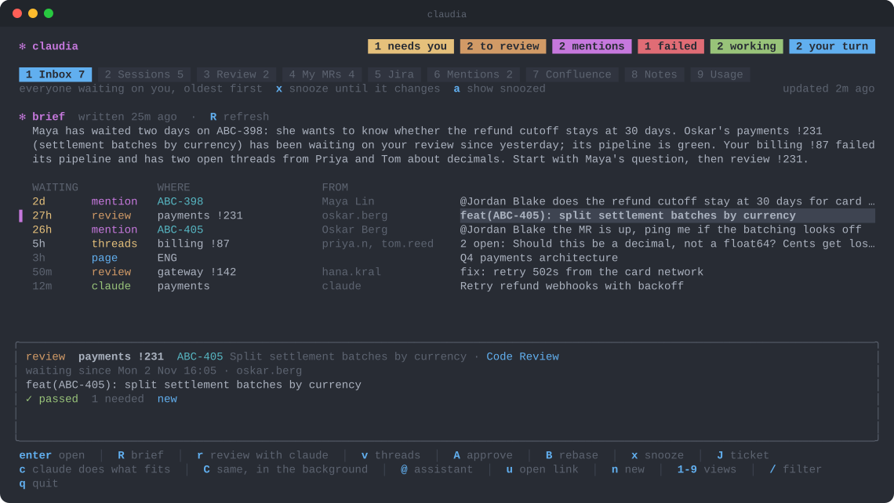
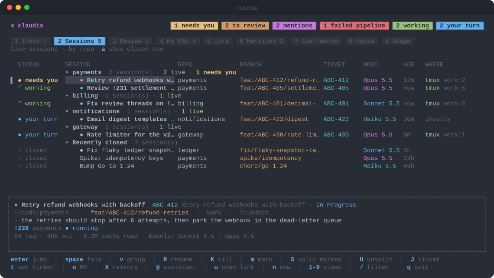
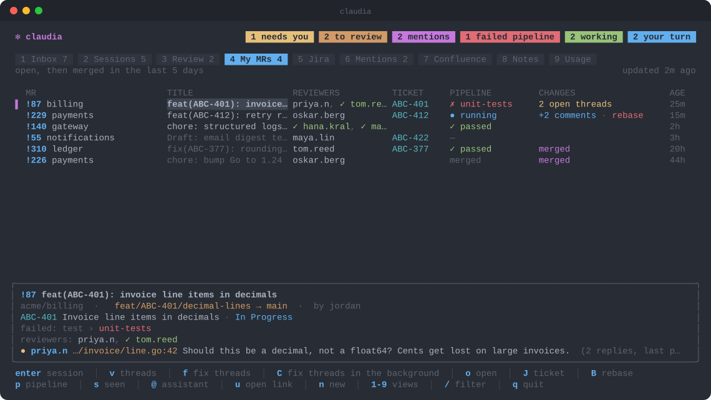
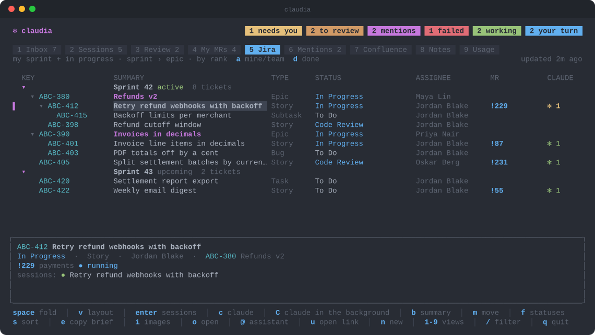
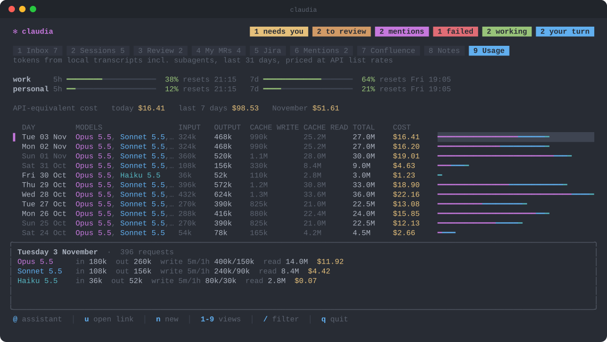

<p align="center">
  
</p>

<h1 align="center">claudia</h1>

<p align="center">
  <b>A terminal cockpit for Claude Code.</b><br>
  Who's waiting on you, your merge requests, your sprint and every Claude session, in one TUI.
</p>

<p align="center">
  <a href="https://github.com/MartyJRE/claudia/actions/workflows/ci.yml"></a>
  
  
  
  
  
</p>

<p align="center">
  
</p>

claudia lists review requests, Jira and Confluence mentions, Teams messages,
review threads on your MRs and Claude sessions that need input, oldest first, and jumps you into the
right Claude Code session for each: a review, a drafted reply, the fixes.

Claude itself always runs as the real `claude` CLI in tmux windows, so nothing
of Claude Code is reimplemented or lost. claudia only finds, starts, resumes and
switches between those sessions.

## Views

| Key | View | What it shows |
|---|---|---|
| 1 | Inbox | Everyone waiting on you, oldest first |
| 2 | Sessions | Live and recent Claude sessions with status, branch, ticket, model, and a line on where each stands |
| 3 | Review | MRs where you are a reviewer and haven't approved yet |
| 4 | My MRs | Your open MRs (reviewers, pipelines, review threads) and recently merged ones |
| 5 | Jira | Your sprint, or the team's |
| 6 | Mentions | Jira comments and Confluence pages that mention you |
| 7 | Confluence | Pages you edited recently |
| 8 | Notes | Your Obsidian vault as a folder tree, or recently edited first |
| 9 | Usage | Tokens and API-equivalent cost per day, plan limits |

**Sessions**, grouped by repo, each with its `/color` dot. Under each one, a
line says where it stands ("OK to merge?", "Waiting: Michal to approve",
"PR #5 open"). The watcher writes it on Haiku when the session stops, from the
last few turns, in a separate headless run that leaves the session itself
alone. When it says Claude is asking you something, the session shows
`◆ needs you` and joins the Inbox, as if it were waiting on a prompt; when it
says the work is done, `✓ done`, so finished sessions stand out to close.
A group holding a single session is just that session's row, with the group
named on it, so there's no header to scroll past:



**My MRs**, with pipelines, approvals and what changed since you last looked:



**Jira**, your sprint as sprint › epic › story:



**Usage**, cost per day split by model, and plan limits:



`u` opens any link in Claude (also `claudia open <link>` from a shell): an MR
link gets reviewed in your local clone even if it isn't assigned to you, a Jira
link gets what the ticket needs, anything else lands in a repo you pick. `n`
starts a plain session in any repo.

The Inbox opens with a short brief in plain English, written by a headless
`claude -p` over claudia's own data (no tools): who's waited longest, what's
failing, what to do next. It's rewritten every `brief_every` (default `2h`, `off`
to disable) and on `R`; `claudia brief` prints a fresh one. `@` opens a
long-lived assistant session that knows claudia's commands, for "what should I
do first?" and small errands.

With an Obsidian vault configured, every ticket shows its notes: the ones in
its project folder and every note that mentions the key (an epic includes its
stories' notes). `N` lists them, `enter` reads one, `e` edits it in your editor (`$VISUAL`, else `$EDITOR`, else vi),
`w` writes a new one into the ticket's folder.

`c` starts the Claude session the item calls for: a review for a review request,
a drafted reply for a mention, fixes for review threads. On a ticket it asks
which kind (analysis, implementation, general, review, …), with the one that
fits the ticket's state preselected, so `enter` just goes. `C` does the same in
the background: you stay in claudia and get a ping when it needs you.

`V` selects several rows, like vim's line-wise visual mode: `j`/`k` extend it,
`c` (or `C` for the background) asks what to do with them, e.g. "close all of
these", and hands the lot to one Claude session. It lists what it will do and
waits for your go-ahead before anything that can't be undone. Works in the
Inbox, Review, My MRs, Jira, Mentions and Confluence. Every view lists its
keys in the footer.

In Sessions, the live ones stay in the order they started, so activity never
reshuffles the list. Below them, **Recently closed** keeps the last few closed
sessions a keypress from coming back.

| Key | In Sessions |
|---|---|
| `enter` | jump to the session, or resume a closed one |
| `R` | resume a closed session |
| `K` | kill a session; the transcript stays, so `R` brings it back |
| `m` / `S` / `U` | mark sessions, tile the marked ones side by side, send them back |
| `t` / `J` | set the session's ticket / go to it |
| `o` / `y` | open its MR / copy its id |
| `P` | comment inline on its plan, see [Plans](#plans) |
| `v` / `a` / `space` | layout: by repo, by ticket or flat / show every closed one / fold a group |

`S` tiles the marked sessions (plus the one under the cursor) into one window in
a `splits` tmux session and takes you there; closing one re-tiles the rest. `U`
sends each back to a window of its own in the session it came from.

Every key can be rebound, see `keys` under [Configuration](#configuration).

## Plans

When a session in plan mode shows you its plan, `P` on it (in Sessions, or on
its Inbox item) opens the plan for inline comments, instead of editing the
plan file in your editor. Only when you ask for it; plans you're happy with
you approve in Claude as usual.

`j`/`k` move, `V` selects several lines, `c` comments on the line or the
selection (`alt+enter` for a new line in the comment), `e` edits and `d`
deletes the comment under the cursor. `s` sends them all to the session's plan
prompt as "Tell Claude what to change", each under the lines it's about:

```
Comments on the plan:

> - Keep state in `migrations/state.json`
put it in the DB instead, the file is gone after a redeploy
```

and Claude revises the plan. Comments are kept until they're sent, and follow
their lines when the plan changes. When the session isn't in tmux or its prompt
isn't open, the feedback is copied for you to paste.

From inside the session's own tmux window, bind a key to open it as a popup
over the pane (`claudia plan` finds the session in the pane under it):

```tmux
bind P display-popup -E -w 90% -h 85% -b rounded -s 'bg=#282c34' -S 'fg=#c678dd' "$HOME/go/bin/claudia plan"
```

## Teams

With [Teams set up](#teams-setup), the Inbox also lists Microsoft Teams chats
where someone else had the last word, and @mentions of you in any channel you
haven't answered in the thread. They stay until you reply or snooze them with
`x`, even after you've read them in Teams, so nothing slips. `enter` opens the
message in the Teams app; `c` starts a session that reads the conversation and
drafts your reply, and sends it only after you OK the text. Replies keep
Markdown code as code, and can carry images (`--image`, shown in the message)
and files (`--file`).

Meeting invites you haven't answered show up too; `c` on one asks accept,
tentative or decline. The brief knows the rest of today's meetings.

With [mail turned on](#outlook-mail), unread Outlook mail that needs you shows
up as well, until you read it. `enter` opens it in Outlook; `c` drafts a reply
for you to paste there.

Review requests posted in your code-review channel are matched to their MRs (a
post can cover several MRs, and an MR can be posted more than once). The Review
row shows a `teams` chip, `teams ✓` once you've replied in the thread, and `T`
opens the post. A review session is told about the post, so when it's done it
proposes a reply or a ✅ for the thread.

## Claude can drive it too

Every session claudia starts or resumes is told about `claudia ctl`, so you can
ask Claude "is this merged yet?" and it checks, answers, clears the item from
your inbox and switches you back to claudia:

```sh
claudia ctl here            # this session's MRs, ticket and inbox items, as JSON
claudia ctl inbox           # the whole inbox
claudia ctl dismiss --here  # snooze this session's inbox items until they change
claudia ctl home [--close]  # back to claudia; --close also ends the session
```

## Commands

```sh
claudia                 # open claudia in its own tmux session
claudia open <link>     # hand a link to claudia, as `u` does
claudia brief           # print a fresh inbox brief
claudia keys            # every key action, its current keys and any clashes
claudia update          # install the newest release from GitHub (ctrl+u inside claudia)
claudia version         # the release (or commit) this binary was built from
claudia setup           # build the native notification helper
claudia ctl help        # the commands Claude sessions use, see above
claudia teams help      # Teams: login, waiting, show, reply, react, see below
claudia plan [pane]     # comment on the plan of the session in a tmux pane (default: the active one)
```

## Requirements

- macOS, tmux, Go 1.24+
- [`glab`](https://gitlab.com/gitlab-org/cli), logged in (claudia uses its login)
- Claude Code
- Optional: Ghostty (images, notification click-through), a Swift toolchain for
  the native notification helper, an Entra app for [Teams](#teams-setup)

## Install

```sh
go install github.com/MartyJRE/claudia@latest
claudia setup                # native notifications: builds ~/Applications/Claudia.app (needs Xcode CLT)
```

Each [release](https://github.com/MartyJRE/claudia/releases) also has
prebuilt binaries for macOS and Linux (amd64 and arm64).

### Updates

claudia checks GitHub for a new release every hour and shows `⬆ update` in the
header when there is one. `ctrl+u` (or `claudia update`) lists what's new since
your version, reinstalls with `go install …@latest` and restarts the background
watcher; read the notes while it builds, then `enter` restarts claudia, or
`esc` keeps the running one until you quit. `W` opens the release notes at any
time: `[` and `]` step to the older and newer release, and the one you run is
marked installed.

In `~/.tmux.conf`, to toggle between claudia and the session you came from:

```tmux
bind C if -F '#{==:#{session_name},claudia}' 'switch-client -l' 'new-session -A -s claudia "$HOME/go/bin/claudia ui"'
bind P display-popup -E -w 90% -h 85% -b rounded -s 'bg=#282c34' -S 'fg=#c678dd' "$HOME/go/bin/claudia plan"
set -g allow-passthrough on   # ticket images through tmux
```

Run `claudia` to open it in its own tmux session.

When a Claude session starts waiting on you while you're in another tmux session,
it shows up there as an extra tab. The tab goes away once you've answered and
switched to another tab; the window stays in its repo's session throughout.

Claude windows are named with a Nerd Font icon for what they were started for
(review, fixing threads, a reply, analysis, implementation, a link, or a robot
for anything else), and get a bell after the name while they need you.

Each session claudia starts or resumes without a colour gets one with Claude's
`/color`, picking the one least used among live sessions, so the prompt bars of
sessions running side by side differ. The Sessions list shows it as a dot.

## Configuration

`~/.config/claudia/config.json` (every field is optional). Press `,` to edit it
from inside claudia: text, paths and switches change in place, maps and lists
open as JSON in `$EDITOR`, and `ctrl+s` saves and restarts claudia. Fields set
by an environment variable are shown but can't be changed there.

```json
{
  "atlassian_url": "https://your-site.atlassian.net",
  "jira_project": "ABC",
  "ticket_keys": ["ABC", "OPS"],
  "gitlab_host": "gitlab.example.com",
  "code_root": "~/Documents/Code",
  "work_dir": "Work",
  "review_prompt": "/review-mr {urls}",
  "analysis_prompt": "/story-analysis {key}",
  "session_names": {"analysis": "{key}-analysis", "general": "{key}"},
  "keys": {"sessions.close": "ctrl+w", "global.down": ["j", "down"]}
}
```

- `gitlab_host` defaults to glab's configured host.
- Claude profiles: every `~/.claude` and `~/.claude-<name>` dir with sessions is
  picked up (named `default` and `<name>`). Name them yourself with
  `"profiles": {"work": "~/.claude-work", "personal": "~/.claude"}`.
- `work_dir` is the folder under `code_root` whose repos are listed first and
  started with the `work` profile (`work_profile` to pick another); other repos
  use `personal` if it exists.
- `vault`: an Obsidian vault, e.g. `"~/Documents/Notes"`; `vault_projects` is its
  folder with one subfolder per ticket (default `01 - Projects`).
- `remote_control`: profiles whose sessions start with Remote Control, e.g. `["work"]`.
- `review_prompt`, `analysis_prompt` and `implementation_prompt` let you point at
  your own skills; the defaults are plain prompts.
- `session_names` names sessions per intent: `analysis`, `implementation`,
  `general`, `continue`, `test`, `review`, `fix`, `reply`. `{key}`, `{summary}`
  and `{verb}` are filled in. Without it, sessions are named `<verb>: <summary>`.
- `rounded_pills: false` draws pills and tabs square, for fonts without the Nerd
  Font half circles. Ghostty ships those, so the default is rounded.
- `keys` rebinds any key outside text input: an action name to a key or a list
  of keys. `claudia keys` lists every action with its current keys and points out
  clashes. claudia also flags clashes when it starts.

Credentials stay in the environment: `ATLASSIAN_EMAIL` and `ATLASSIAN_API_TOKEN`
(an [Atlassian API token](https://id.atlassian.com/manage-profile/security/api-tokens)).

Plan limits come from Claude Code's status line. Add this to your status line
script to hand them to claudia:

```sh
if limits=$(jq -ce 'select(.rate_limits) | {rate_limits, at: now}' <<< "$input" 2>/dev/null); then
  out="${XDG_STATE_HOME:-$HOME/.local/state}/claudia"; mkdir -p "$out"
  f="$out/limits-$(basename "${CLAUDE_CONFIG_DIR:-$HOME/.claude}").json"
  printf '%s' "$limits" > "$f.tmp" && mv "$f.tmp" "$f"
fi
```

State and caches live in `~/.local/state/claudia`.

### Teams setup

claudia reads and writes Teams through Microsoft Graph as you, with an Entra app
registration of your own:

1. Register an app (single tenant) and turn on **Allow public client flows**
   under Authentication.
2. Give it the delegated Microsoft Graph permissions `User.Read`,
   `Chat.ReadWrite`, `ChannelMessage.Read.All`, `ChannelMessage.Send`,
   `Team.ReadBasic.All`, `Channel.ReadBasic.All`, `Calendars.ReadWrite` and
   `offline_access`, and have an admin grant consent (`ChannelMessage.Read.All`
   always needs one). Optional ones turn on more: `Mail.Read` for mail in the
   Inbox, `Chat.Create` and `User.ReadBasic.All` for `chat` and `who`, and
   `Files.ReadWrite.All` for `--file` and `download`. Sign-in asks for whatever
   the app has been granted, so a permission still waiting on an admin never
   breaks it; the feature that needs it says so, the rest works. Run
   `claudia teams login` again once a new one is granted.
3. Add it to the config and sign in once:

```json
"teams": {
  "tenant": "<directory (tenant) id>",
  "client_id": "<application (client) id>",
  "me": "Your Teams Name",
  "team_id": "<team id>",
  "channel_id": "<code-review channel id>"
}
```

```sh
claudia teams login       # device code; the token is kept in claudia's state dir
claudia teams channels    # your teams and channels, to fill in team_id / channel_id
```

`team_id` and `channel_id` are only for the review channel; chats and mentions
work without them. `me` tells your replies apart from others'.

#### Outlook mail

Mail shows up once `teams.mail` is set and the app has `Mail.Read`:

```json
"mail": {
  "direct": true,
  "rules": [{"from": "boss@example.com"}, {"subject": "approval needed"}]
}
```

`direct` (on by default) lists mail with you in To that Outlook files as
Focused; each rule lists mail whose sender (address or name) and subject
contain what it sets, whoever it was sent to.
Only unread mail from the last two weeks counts.

```sh
claudia teams waiting                       # chats, @mentions, invites and mail waiting on you, as JSON
claudia teams show <ref>                    # the conversation, oldest first, with its files
claudia teams posts [--mr <url>]            # review-channel posts, or the ones about an MR
claudia teams reply <ref|mr-url> <text>     # into the chat or thread
claudia teams react <ref|mr-url> ✅
claudia teams chat <who>[,<who>] <text>     # start a chat (names or emails); several make a group
claudia teams post <Team/Channel> <text>    # start a new thread in a channel
claudia teams who <name|email>              # find a person
claudia teams download <file-url> [dir]     # save a file shared in Teams
claudia teams calendar [days]               # your meetings from now
claudia teams respond <event-ref> accept|tentative|decline [comment]
```

`reply`, `chat` and `post` take `--file <path>` (repeatable): files go to your
OneDrive's Teams chat folder for a chat, or the channel's own files folder.
`--image <path>` (repeatable; PNG, JPEG or GIF) shows the image in the message
itself, like a pasted screenshot, and needs no file permission.

## Contributing

Found a bug or have an idea? [Open an issue](https://github.com/MartyJRE/claudia/issues/new/choose).
The forms ask for what you need to be specific: steps, `claudia version`, your
setup.

CI runs on every push to `main` and every PR. To check locally before pushing:

```sh
gofmt -l . && go mod tidy -diff && go vet ./... && go test -race ./...
```

Every green push to `main` is released: CI tags it with the next patch version
and goreleaser publishes the binaries, with notes grouped by the commit
subject's `scope:`. A `Release: minor` or `Release: major` trailer in any commit
since the last release bumps that part instead.

The tmux tests start a private tmux server, so they never touch your sessions.
`TestPlanReviewInTmux` goes end to end: it builds the binary, runs a stand-in
Claude plan prompt (`internal/tmux/testdata/fakeplan.py`, needs `python3`) in one
pane and `claudia plan` in another, types comments through tmux and checks the
exact bytes the prompt receives. `go test -short` skips it.

The screenshots in `assets/` are rendered from the real UI with demo data:

```sh
CLAUDIA_PREVIEWS=assets go test ./internal/ui -run TestWritePreviews
```

The notification helper in `notifier/` is a Swift package: its logic lives in
`NotifierCore`, with the AppKit and UserNotifications wiring in the thin
`claudia-notify` executable. `notifier/coverage.sh` runs its tests and prints
NotifierCore's coverage; `notifier/build.sh /tmp/Claudia.app` builds the app
somewhere other than `~/Applications`.
