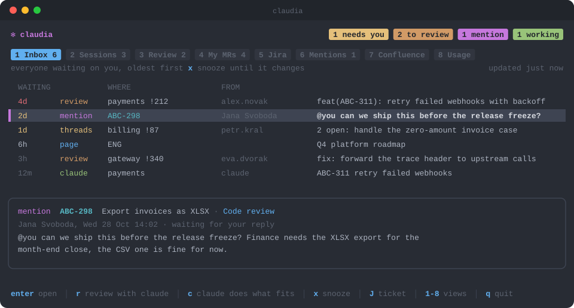

<p align="center">
  
</p>

<h1 align="center">claudia</h1>

<p align="center">
  <b>A terminal cockpit for Claude Code.</b><br>
  Who's waiting on you, your merge requests, your sprint and every Claude session, in one TUI.
</p>

<p align="center">
  
  
  
</p>

<p align="center">
  
</p>

claudia lists review requests, Jira and Confluence mentions, review threads on
your MRs and Claude sessions that need input, oldest first, and jumps you into the
right Claude Code session for each: a review, a drafted reply, the fixes.

Claude itself always runs as the real `claude` CLI in tmux windows, so nothing
of Claude Code is reimplemented or lost. claudia only finds, starts, resumes and
switches between those sessions.

## Views

| Key | View | What it shows |
|---|---|---|
| 1 | Inbox | Everyone waiting on you, oldest first |
| 2 | Sessions | Live and recent Claude sessions with status, branch, ticket, model |
| 3 | Review | MRs where you are a reviewer and haven't approved yet |
| 4 | My MRs | Your open MRs (reviewers, pipelines, review threads) and recently merged ones |
| 5 | Jira | Your sprint, or the team's |
| 6 | Mentions | Jira comments and Confluence pages that mention you |
| 7 | Confluence | Pages you edited recently |
| 8 | Usage | Tokens and API-equivalent cost per day, plan limits |

`u` opens any link in Claude (also `claudia open <link>` from a shell): an MR
link gets reviewed in your local clone even if it isn't assigned to you, a Jira
link gets what the ticket needs, anything else lands in a repo you pick. `n`
starts a plain session in any repo.

`c` starts the Claude session the item calls for: a review for a review request,
a drafted reply for a mention, fixes for review threads, an analysis for a new
ticket. Every view lists its keys in the footer.

## Claude can drive it too

Every session claudia starts or resumes is told about `claudia ctl`, so you can
ask Claude "is this merged yet?" and it checks, answers, clears the item from
your inbox and switches you back to claudia:

```sh
claudia ctl here            # this session's MRs, ticket and inbox items, as JSON
claudia ctl inbox           # the whole inbox
claudia ctl dismiss --here  # snooze this session's inbox items until they change
claudia ctl home [--close]  # back to claudia; --close also ends the session
```

## Requirements

- macOS, tmux, Go 1.24+
- [`glab`](https://gitlab.com/gitlab-org/cli), logged in (claudia uses its login)
- Claude Code
- Optional: Ghostty (images, notification click-through), a Swift toolchain for
  the native notification helper

## Install

```sh
go install github.com/MartyJRE/claudia@latest
./notifier/build.sh          # optional: native notifications, builds ~/Applications/Claudia.app
```

In `~/.tmux.conf`, to toggle between claudia and the session you came from:

```tmux
bind C if -F '#{==:#{session_name},claudia}' 'switch-client -l' 'new-session -A -s claudia "$HOME/go/bin/claudia ui"'
set -g allow-passthrough on   # ticket images through tmux
```

Run `claudia` to open it in its own tmux session.

## Configuration

`~/.config/claudia/config.json` (every field is optional):

```json
{
  "atlassian_url": "https://your-site.atlassian.net",
  "jira_project": "ABC",
  "ticket_keys": ["ABC", "OPS"],
  "gitlab_host": "gitlab.example.com",
  "code_root": "~/Documents/Code",
  "work_dir": "Work",
  "review_prompt": "/review-mr {urls}",
  "analysis_prompt": "/story-analysis {key}"
}
```

- `gitlab_host` defaults to glab's configured host.
- Claude profiles: every `~/.claude` and `~/.claude-<name>` dir with sessions is
  picked up (named `default` and `<name>`). Name them yourself with
  `"profiles": {"work": "~/.claude-work", "personal": "~/.claude"}`.
- `work_dir` is the folder under `code_root` whose repos are listed first and
  started with the `work` profile (`work_profile` to pick another); other repos
  use `personal` if it exists.
- `remote_control`: profiles whose sessions start with Remote Control, e.g. `["work"]`.
- `review_prompt` and `analysis_prompt` let you point at your own skills; the
  defaults are plain prompts.

Credentials stay in the environment: `ATLASSIAN_EMAIL` and `ATLASSIAN_API_TOKEN`
(an [Atlassian API token](https://id.atlassian.com/manage-profile/security/api-tokens)).

Plan limits come from Claude Code's status line. Add this to your status line
script to hand them to claudia:

```sh
if limits=$(jq -ce 'select(.rate_limits) | {rate_limits, at: now}' <<< "$input" 2>/dev/null); then
  out="${XDG_STATE_HOME:-$HOME/.local/state}/claudia"; mkdir -p "$out"
  f="$out/limits-$(basename "${CLAUDE_CONFIG_DIR:-$HOME/.claude}").json"
  printf '%s' "$limits" > "$f.tmp" && mv "$f.tmp" "$f"
fi
```

State and caches live in `~/.local/state/claudia`.
